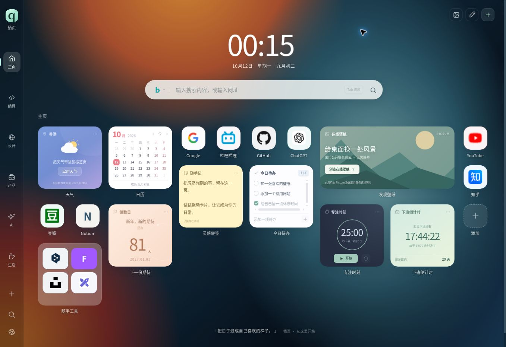

<p align="center">
  
</p>

<h1 align="center">栖页 Qiye</h1>

<p align="center"><strong>让每一次打开，都有一处喜欢的风景。</strong></p>
<p align="center">v0.2.1 · Chrome / Edge · Manifest V3 · 无栖页账号 · 自有 WebDAV</p>

栖页是一款可以自由编排的浏览器新标签页扩展：把常用网站、搜索、日常小组件和喜欢的壁纸放在一起。布局与交互参考 iTab，栖页品牌、界面图标和代码独立实现；网站卡片按网址加载目标网站的图标。当前功能范围与验收状态见下文。

**[在线演示 · GitHub Pages](https://ktclat.github.io/qiye.ktclat.github.io/)** · [源码仓库](https://github.com/Ktclat/qiye) · [安装扩展](#安装与更新) · [WebDAV 配置](#webdav-同步) · [开发指南](#本地开发) · [隐私说明](docs/PRIVACY.md)

> 完整源码保存在本仓库；网页由 [Ktclat/qiye.ktclat.github.io](https://github.com/Ktclat/qiye.ktclat.github.io) 的 GitHub Pages 发布。两个版本使用同一份生产模块。[部署与域名迁移说明](docs/DEPLOYMENT.md)。

公开演示无需登录。每位访问者的桌面保存在自己的浏览器中，访问同一个演示链接不会共享便签、网址或同步配置。



*GitHub Pages 实际运行截图，拍摄于 2026-10-11（UTC）；页面时间按浏览器所在时区显示。*

## 功能一览

| 能力 | 当前实现 |
| --- | --- |
| 自由编排桌面 | 侧栏分组、网站与文件夹、跨组移动、编辑模式拖拽、复制、删除与撤销 |
| 网站真实图标 | 默认自动加载对应网站图标；可主动智能提取网站声明的图标，或改用文字模式 |
| 多尺寸卡片 | 网站与文件夹支持 `1×1`、`2×1`、`2×2`、`4×2`；组件支持 `2×2`、`4×2` |
| 搜索与收藏 | 必应、百度、Google、DuckDuckGo、哔哩哔哩；自定义 `{q}` 搜索模板；查找本机收藏 |
| 浏览器集成 | 按需授权书签导入与查找、历史查询；工具栏与右键菜单收藏网页或链接 |
| 外观 | 大时钟、公历与农历、极简模式、浅色/深色/跟随系统、网格间距与圆角设置 |
| 壁纸 | 六款内置渐变、内置背景每日轮换、本地图片/视频、Picsum 摄影壁纸组件、模糊与暗度 |
| 数据 | 本机保存、JSON 导入导出、自有 WebDAV 同步、覆盖前的版本与冲突检查 |

### 13 类小组件

| 组件 | 用途与边界 |
| --- | --- |
| 在线壁纸 | 主动开启后浏览 Picsum 摄影图库，换图、换一组、应用背景 |
| 天气 | 默认关闭；启用后通过 Open-Meteo 查询所选城市，使用 30 分钟缓存 |
| 日历 | 公历月份与中国农历 |
| 便签 | 自动保存随手记录 |
| 待办清单 | 添加、勾选与删除任务 |
| 倒数日 | 为指定日期设置标题与倒计时 |
| 专注计时 | 可暂停的番茄钟，根据时间记录恢复计时 |
| 下班倒计时 | 工作日下班与发薪日倒计时 |
| 每日一句 | 展示与配置摘录内容 |
| 热搜入口 | 跳转到各平台热门内容页面，不获取或展示实时排名 |
| 计算器 | 加减乘除、括号与百分比计算 |
| 习惯打卡 | 每日记录与连续天数 |
| 世界时钟 | 配置城市时区并查看时间 |

同类便签、待办、习惯、专注卡片分别共用一份数据，天气卡片共用城市设置。倒数日、下班设置、摘录和世界时钟可按卡片配置。右上角“＋”可以添加内容，右键卡片可以编辑或调整尺寸。

## 安装与更新

### Chrome / Edge 安装

1. 在本仓库点击 **Code → Download ZIP** 并解压，或将仓库克隆到本地。
2. Chrome 在地址栏打开 `chrome://extensions/`；Edge 打开 `edge://extensions/`。
3. 开启“开发者模式”，点击“加载已解压的扩展程序”。
4. 选择**直接包含 `manifest.json` 的仓库根目录**，然后新建标签页。

使用扩展无需 Node.js、`npm install` 或构建。Manifest 声明的最低 Chrome 版本为 **116**；目前面向 Chrome / Edge，尚未适配 Firefox。当前安装方式为加载源码目录。

使用 Git 获取源码：

```sh
git clone https://github.com/Ktclat/qiye.git
cd qiye
```

更新前可在“设置 → 数据”导出备份。保留原安装目录，更新其中的源码，再到扩展管理页点击“重新加载”。v0.2.1 支持已有的 v0.1 / v0.2 备份，旧桌面布局会保留；缺少图标模式的旧网站卡片默认使用自动模式，并保留原文字或内置图标作为回退。新壁纸卡片可通过“壁纸 → 打开小组件”添加。

### 网页与扩展有什么区别？

| 项目 | 网页 / 独立 HTML | 扩展安装版 |
| --- | --- | --- |
| 桌面、搜索、组件与外观 | 支持 | 支持 |
| 替换浏览器新标签页 | 需自行打开页面 | 安装后由扩展接管 |
| 桌面存储 | 当前来源的 `localStorage` | `chrome.storage.local` |
| JSON 导入导出 | 支持 | 支持 |
| WebDAV | 服务须允许当前网页跨域访问（CORS） | 按需申请所填服务站点的访问权限 |
| 网站图标 | 可显示站点图片；读取网页提取图标受 CORS 限制 | 主动提取时按站点请求访问权限，可使用浏览器图标回退 |
| 书签、历史、工具栏与右键收藏 | 无扩展接口 | 按功能使用或授权 |
| `Alt+C` 扩展快捷键 | 不支持 | 打开新的栖页本地搜索页 |

仓库内的 `Qiye-preview.html` 可直接打开，包含桌面所需的脚本和样式；联网功能仍需网络。公开网站、独立 HTML 与扩展各自保存数据，可通过 JSON 备份迁移，或配置同一份 WebDAV 文件同步。直接打开本地 HTML 时，持久化与跨域访问还受浏览器对本地文件的策略影响。

网页更换域名后，需要从原页面导出 JSON 并在新页面导入，或重新连接同一 WebDAV 文件；WebDAV 凭据需要在新页面重新填写。GitHub Pages 的发布配置与迁移步骤见 [部署指南](docs/DEPLOYMENT.md)。

## 网站图标与智能提取

网站卡片默认选择“自动获取网站图标”。它优先使用本机已成功加载或提取的候选，再尝试目标站点的 `/favicon.ico`、`/apple-touch-icon.png`；扩展版还会尝试浏览器提供的图标。候选依次加载，真正加载成功后才显示图片；全部失败时仍显示原文字、Emoji 或内置图标。这里直接使用网站自身或其声明的图片地址，不接入第三方 favicon 代理服务。

在“新增网站”或“编辑网站”中，可以选择两种模式：

| 图标显示 | 行为 |
| --- | --- |
| 自动获取网站图标（`auto`） | 尝试网站真实图标，失败时使用下方的文字回退 |
| 使用文字 / Emoji（`text`） | 显示“文字 / Emoji 回退”和背景色，不为该卡片主动加载远端图标 |

需要查找更合适的图标时，填好网站地址、选择自动模式，再点击 **“智能提取”**。扩展会按需请求该网站的读取权限。提取器读取页面 HTML 中的 `rel="icon"`、`apple-touch-icon` 等声明，结合尺寸和格式选择候选；HTML 图标不足时，会读取页面声明的**同源 Web App Manifest** 并补充其中的 `icons`。它只解析元数据，不执行页面脚本或把抓取的 HTML 插入界面。按钮返回候选后仍需完成图片加载，候选提取成功不代表图片一定可用。

页面和清单读取保留地址路径，去掉查询参数与片段；仅处理公开域名的 HTTPS 地址，HTTP 网址会尝试 HTTPS。localhost、IP 地址、自定义端口或跨来源跳转不会被用于读取提取。**GitHub Pages 等网页版受目标站点的 CORS 策略限制**：不能读取 HTML 时会提示并回退到常规图标地址，图片本身仍可能正常显示。扩展拒绝站点权限、超时或遇到不支持的页面时也保留文字回退，可继续使用该网址。

已提取的候选与成功加载的图标地址在本机缓存 **7 天**，最多保存 **200 个页面**；提取失败暂避 **10 分钟**，图片加载失败在当前页面暂避 **5 分钟**。主动点击“智能提取”可以重新尝试。缓存保存的是地址与状态，图片文件由浏览器正常加载和缓存。图标模式和原文字回退会随 JSON 备份 / WebDAV 同步，提取缓存不会同步；新设备可重新提取。

## WebDAV 同步

不需要栖页账号。栖页直接连接你提供的 WebDAV 服务，将整份桌面保存为一个 JSON 文件；多台设备使用相同目录和文件名即可比较与同步。

### 配置步骤

打开“设置 → 同步”，填写以下内容。地址仅为格式示例，请替换为自己的服务。

| 字段 | 示例 / 要求 |
| --- | --- |
| WebDAV 目录地址 | `https://dav.example.com/qiye/`，必须是**已经存在的目录** |
| 用户名 | WebDAV 服务提供的用户名 |
| 密码 / 应用密码 | 服务对应的凭据；已保存后留空会保留原密码 |
| 同步文件 | 默认 `qiye.json`；相对于上述目录，文件名须以 `.json` 结尾 |

1. 可先点击“测试连接”。测试只读取文件，不保存配置、不创建文件，也不验证写入权限；`404` 仍需确认父目录存在。
2. 点击“保存并启用”。扩展会按需请求该服务站点的访问权限。
3. 点击“立即同步”。空位置在首次手动同步时尝试创建文件；已有不同桌面会先显示版本选择。
4. 根据比较结果选择“保留本机”或“使用远端”。确认前可分别导出本机与远端副本；后者会替换本机桌面。

栖页不会自动创建目录。连接使用 HTTPS，仅 `localhost` / `127.0.0.1` 允许 HTTP；请填写服务的最终目录地址，客户端拒绝重定向。

### 自动检查与冲突处理

完成一次手动同步后，可开启“自动检查同步”。它只在栖页**打开、可见且空闲**时检查：本机单端修改可自动上传，远端更新或双端修改需要确认。关闭栖页后不执行后台同步。

同步按整份桌面处理，不逐字段合并。首次发现不同远端、双端都修改、远端被删除，或用户确认期间任一版本变化时，会重新比较或请求确认；旧确认不能静默覆盖新数据。

服务需要支持 HTTP 条件写入：创建使用 `If-None-Match: *`，覆盖已有文件使用强 `ETag` 与 `If-Match`，上传后还会读回校验。**已有文件缺少强 ETag 时仍可下载，但不能覆盖上传**；弱 ETag（以 `W/` 开头）不能用于这里的版本保护。

### 网页版的 CORS 要求

若从公开演示或其他网页连接，WebDAV 服务需要允许相应网页来源跨域访问：

| 配置项 | 要求 |
| --- | --- |
| 允许来源 | GitHub Pages 使用 `https://ktclat.github.io`，来源中不包含 `/qiye.ktclat.github.io/` 路径；其他部署使用对应网页来源 |
| 允许方法 | `GET`、`PUT`、`OPTIONS` |
| 允许请求头 | `Authorization`、`Content-Type`、`If-Match`、`If-None-Match` |
| 暴露响应头 | `Access-Control-Expose-Headers: ETag` |

具体配置取决于你的服务及反向代理。服务不支持网页跨域访问时，可使用扩展安装版；强 ETag 与条件写入要求仍然适用。当前尚未完成具体服务商的账户联调，因此不承诺某一服务即配即用。

## 壁纸与数据隐私

### 在线壁纸

公开图片 API 默认关闭。在“在线壁纸”卡片点击“浏览在线壁纸”后启用 [Lorem Picsum](https://picsum.photos/)，无需 API Key。组件保留摄影师、照片来源和条款链接，支持换一张、换一组与手动应用。

缩略图与完整壁纸分别加载，完整图片预加载成功后才替换背景；加载失败保留原背景，过期请求不会覆盖后来选择的壁纸。暂停在线壁纸后停止新的图库请求，并恢复本地背景。元数据缓存为 24 小时；“每日轮换内置背景”轮换的是内置渐变。

### 数据保存与权限

桌面、网址、便签、待办和设置默认保存在本机。栖页没有账号服务器、广告脚本或行为遥测，也不从 CDN 加载运行脚本。网站卡片默认使用自动图标，会向对应站点或该站点声明的图片 CDN 加载图标；在线壁纸、天气与 WebDAV 在对应功能启用或用户操作后访问外部服务。搜索提交与网址点击会访问所选网站。

WebDAV 地址、用户名、密码及同步基线单独保存在本机，**不包含在 JSON 导出或远端同步文件中**。本机凭据未另行加密；远端桌面是普通 JSON，**未提供端到端加密**，应保存到自己的私有目录。同步内容会包含便签、网址等个人桌面数据，以及所选本地壁纸素材。

| 项目 | 说明 |
| --- | --- |
| 基础权限 | `storage` 保存数据；`activeTab`、`contextMenus` 用于主动收藏页面或链接；`favicon` 用于浏览器图标回退 |
| 可选权限 | 书签、历史按需授权；WebDAV 按所填来源申请访问权限；智能提取按目标站点申请访问权限 |
| 图片权限 | Picsum 使用固定站点权限，功能默认关闭 |
| 天气 | 主动开启后发送所选城市经纬度，不读取设备精确定位 |
| 大小限制 | 单个本地图片/视频最大 **4 MiB**，JSON 备份最大 **6 MiB**；网页还受存储配额限制 |

“暂停同步”保留配置和数据；“清除本机连接”只删除当前浏览器中的 WebDAV 配置与同步记录，保留桌面及远端文件。重置桌面不会直接删除远端文件，但启用的自动同步会继续同步桌面变化。更多说明见 [PRIVACY.md](docs/PRIVACY.md)。

## 快捷操作

| 操作 | 效果 |
| --- | --- |
| `/` | 聚焦主搜索框 |
| 搜索框内 `Tab` / `Shift+Tab` | 向后 / 向前切换搜索引擎 |
| `Ctrl+K` / `⌘K`，或 `Ctrl+F` / `⌘F` | 在栖页内打开本地查找 |
| `E` | 切换桌面编辑模式 |
| `Esc` | 关闭菜单/弹层，或退出编辑与极简模式 |
| 点击大时钟 | 切换极简模式 |
| 右键卡片或分组 | 打开对应操作菜单 |
| `Alt+C`（扩展版） | 新建栖页标签并打开本地查找 |

单键快捷操作在非输入状态使用。`Alt+C` 不会在其他网站注入搜索浮层；若快捷键被占用，可在浏览器的扩展快捷键页面调整。历史查询需要明确提交，书签导入只复制所选网址，不修改浏览器原书签。

## 本地开发

项目使用原生 HTML、CSS 和 JavaScript ES Modules，没有第三方运行时依赖或安装步骤。加载扩展后修改源码，在扩展管理页重新加载即可查看更新。

运行逻辑测试使用支持内置测试运行器与 Web Crypto 的 Node.js（建议 Node.js 22 或更新版本）；生成独立预览需要 Python 3。以下命令均在仓库根目录执行：

```sh
# 运行自动化测试，无需 npm install
npm test

# 将同一份生产模块与样式内联为独立 HTML
python3 scripts/build-preview.py

# 可选：通过本地 HTTP 服务打开 index.html 进行网页调试
python3 -m http.server 8000 --bind 127.0.0.1
```

启动本地服务后访问 `http://127.0.0.1:8000/`。网页调试不提供扩展专属接口；这些功能需要加载扩展验证。

`Qiye-preview.html` 是生成文件，**请修改源文件后重新生成**。它由 `index.html`、CSS 和 `src/` 中的生产模块构建，不单独维护第二套界面逻辑。

### 源码结构

| 路径 | 职责 |
| --- | --- |
| `manifest.json` | Manifest V3、权限、新标签页入口与快捷键 |
| `index.html`、`styles.css` | 页面结构与桌面样式 |
| `src/app.js` | 桌面交互、弹层、布局与保存流程 |
| `src/core.js` | 共享状态、持久化、备份校验及浏览器数据接口 |
| `src/favicons.js` | 网站图标候选、网页与清单提取、按需权限、缓存与加载回退 |
| `src/widgets.js`、`src/widgets.css` | 13 类组件的渲染、交互与样式 |
| `src/wallpapers.js` | Picsum 请求、元数据校验、图库翻页与请求状态 |
| `src/webdav.js` | WebDAV 配置、条件请求、版本比较与同步协议 |
| `src/sync-ui.js`、`src/sync.css` | 同步设置、冲突确认与自动检查交互 |
| `src/icons.js`、`icons/` | 界面图标与栖页应用图标 |
| `background.js`、`popup.*` | 扩展菜单、快捷键与工具栏收藏入口 |
| `scripts/build-preview.py` | 生成独立 `Qiye-preview.html` |
| `scripts/build-pages.py` | 将相同生产模块生成为独立发布仓库的静态首页 |
| `.nojekyll`、`docs/DEPLOYMENT.md` | GitHub Pages 静态发布标记、启用与迁移指南 |
| `tests/` | 使用 Node.js 内置测试运行器的逻辑与集成测试 |
| `docs/` | 功能范围、隐私说明与验收记录 |
| `CONTRIBUTING.md` | 提交问题、开发验证与贡献约定 |

### 图标模块接口

`src/favicons.js` 与桌面状态分开管理图标缓存。渲染前可等待 `faviconCacheReady` 加载本机缓存；读取网页声明应由明确的用户点击触发。

| 接口 | 返回值与用途 |
| --- | --- |
| `getFaviconCandidates(siteUrl)` | 同步返回候选 URL 数组；不读取页面 HTML |
| `discoverFavicon(siteUrl, { requestPermission, force })` | 异步返回 `{ url, candidates, source, warning? }`；`url` 是首个候选，`source` 为 `html`、`manifest`、`cache` 或 `fallback` |
| `rememberFavicon(siteUrl, iconUrl)` | 图片 `load` 成功后记录可用地址；返回是否接受该地址，浏览器内部图标 URL 不持久保存 |

桌面里的 `iconMode` 仅允许 `auto` / `text`，缺失时规范化为 `auto`。远端图标 URL、HTML 和缓存对象不能写入桌面 JSON；本机图标缓存使用独立的 `qiye.favicons.local.v1` 记录。

### 验证状态

v0.2.1 在 **2026-10-11（UTC）** 的验证记录为 **124 项通过、0 失败、0 跳过**。覆盖状态与备份校验、旧图标模式迁移、网站图标提取与加载回退、跨标签保存、组件、壁纸请求、WebDAV 条件写入/冲突，以及同步面板调用次序；同时检查了 JavaScript 语法、Manifest 与资源路径、独立预览生成及 GitHub Pages 项目路径兼容性。

测试使用受控网络、DOM 和存储替身运行实际生产函数。GitHub Pages 已实际部署成功：核对了 HTTP 响应与发布文件一致，并在浏览器检查了首页、常用网站图标、智能提取的跨域失败提示和文字模式切换。

以下真实环境验收仍待完成：Chrome / Edge 实装与权限弹窗、更多网站的图标提取与浏览器回退、真实 WebDAV 账户读写、公开壁纸与天气的完整网络链路、图片/视频播放、不同窗口尺寸的视觉与拖拽/键盘交互。**公开部署成功不代表这些项目已经通过。** 完整记录与可执行验收路径见 [QA.md](docs/QA.md)。

## 项目范围与反馈

当前重点是新标签页桌面、日常小组件、WebDAV 与壁纸。账号系统、PDF/OCR/媒体处理等高级工具不在本版范围；暂不扩展行情、赛事或实时榜单等数据组件，保留已有的可选天气与平台入口。当前未适配 Firefox、iTab 私有备份格式或完整浏览器书签管理，也不宣称与参考产品全量或逐像素一致。具体边界见 [FEATURES.md](docs/FEATURES.md)。

欢迎通过 [仓库 Issues](https://github.com/Ktclat/qiye/issues) 提交问题与建议。问题报告请写明版本、Chrome / Edge 版本、使用网页还是扩展、重现步骤及预期/实际结果；同步问题可补充脱敏后的状态码与 ETag/CORS 情况。请勿在公开反馈中附上密码、完整个人备份或其他私密信息。

提交改动时，说明要解决的问题与验证方式；修改界面可附真实截图，修改状态或同步逻辑请覆盖对应行为。更新生产模块后重新生成独立预览，并同步相关文档。具体流程见 [贡献指南](CONTRIBUTING.md)。

## 官方参考

- [Chrome：加载已解压的扩展](https://developer.chrome.com/docs/extensions/get-started/tutorial/hello-world#load-unpacked)
- [Chrome：Storage API](https://developer.chrome.com/docs/extensions/reference/api/storage)
- [Chrome：获取网站图标](https://developer.chrome.com/docs/extensions/how-to/ui/favicons)
- [RFC 4918 §8.6：WebDAV 与 ETag](https://www.rfc-editor.org/rfc/rfc4918#section-8.6)
- [RFC 9110 §13.1：HTTP 条件请求](https://www.rfc-editor.org/rfc/rfc9110#section-13.1)
- [Lorem Picsum：公开摄影 API](https://picsum.photos/)
- [Unsplash License：图片使用条款](https://unsplash.com/license)
- [Open-Meteo：天气 API](https://open-meteo.com/en/docs)
- [iTab：参考产品公开介绍](https://www.itab.link/)
