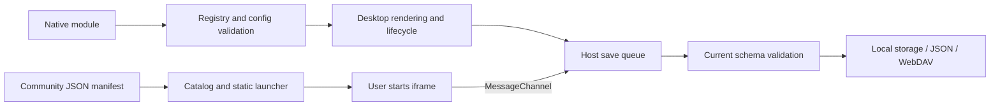

# Widget overview and architecture

[Wiki home](Home-en.md) · [简体中文](Widgets-Overview.md) · **English**

## Choose an integration model

| Dimension | Native API v3 | Community protocol v1 |
| --- | --- | --- |
| Distribution | Local ES Module, reviewed and bundled | Self-hosted HTTPS webpage and JSON manifest |
| Registration | `src/widget-extensions.js` | User subscribes to a manifest or source index |
| Desktop rendering | Author renderer at every declared size | Static launcher; webpage runs explicitly in a detail window |
| Data API | Declared `config`, `getConfig()` / `updateConfig()` | `host.data` / `host.save(value)` |
| Execution | Trusted host environment; not a sandbox | `sandbox="allow-scripts"` iframe + MessageChannel |
| Updates | Extension or web application release | Refresh the source, then explicitly update installed manifests |

Native source can access its execution environment; its API is not a permission boundary. Community APIs do not expose other desktop data, but author webpages can make network requests. See [community widgets](Community-Widgets-en.md) for isolation limits.

## Built-in catalog

The registry contains 14 user-facing built-in widget types. `community` is a separate internal type. All built-ins support the five sizes.

| Type | Name | Behavior and limits |
| --- | --- | --- |
| `wallpaper` | Wallpapers | Every size opens the wallpaper center; galleries load on demand |
| `weather` | Weather | Independent city, unit and network opt-in; observations, hourly/daily forecasts and air quality |
| `calendar` | Calendar | Gregorian/lunar dates, events, date and workday tools; verified mainland China adjustments for 2026 only |
| `memo` | Memos | Multiple plain-text entries, search, pinning, sorting, autosave, undo deletion and TXT export |
| `notes` | Sticky notes | Independent text and color |
| `todo` | To-dos | Add, complete and delete tasks |
| `countdown` | Countdown | Event title and target date |
| `focus` | Focus timer | Pause/resume, restore remaining time from the end timestamp |
| `workday` | Workday countdown | Working days, end time and payday |
| `quote` | Quotes | Custom text/author or built-in quotes |
| `hotlinks` | Trending links | Open platform pages; no live ranking retrieval |
| `calculator` | Calculator | Arithmetic, parentheses and percentages |
| `habit` | Habits | Daily records and streaks |
| `clock` | World clock | IANA timezone, city label and time comparison |

## Runtime structure



Cards and detail workspaces share instance data. Compact built-in cards show summaries. Calendar, memos and weather have dedicated detail views; other daily tools use workspace modules. Detail layouts reflow with the available space.

| Module | Responsibility |
| --- | --- |
| [widget-registry.js](../../src/widget-registry.js) | Types, API versions, fields, defaults and validation |
| [widget-extensions.js](../../src/widget-extensions.js) | Bundled definitions shared across execution contexts |
| [widget-sizes.js](../../src/widget-sizes.js) / [widget-catalog.js](../../src/widget-catalog.js) | Dimensions, catalog and static previews |
| [widget-runtime.js](../../src/widget-runtime.js) / [widget-settings.js](../../src/widget-settings.js) | Native lifecycle and generated configuration forms |
| [widgets.js](../../src/widgets.js) / [widget-summary.js](../../src/widget-summary.js) | Cards, built-in interactions and compact summaries |
| [widget-workspaces.js](../../src/widget-workspaces.js) / [widget-details.js](../../src/widget-details.js) | Daily workspaces, calendar and memo sessions |
| [calendar-view.js](../../src/calendar-view.js) / [memo-view.js](../../src/memo-view.js) / [weather-view.js](../../src/weather-view.js) | Dedicated views |
| [widget-data.js](../../src/widget-data.js) / [widget-drafts.js](../../src/widget-drafts.js) | Instance data, drafts, failed saves and retry |
| [community-format.js](../../src/community-format.js) / [community-widget.js](../../src/community-widget.js) | Manifests, instance JSON and isolated execution |
| [core.js](../../src/core.js) / [validation.js](../../src/validation.js) | Full desktop validation, storage and backups |

## Data model and limits

Each widget card has `config` and `data`. Native extensions keep declared scalar fields in `config` and use `data: {}`. Built-ins have explicit data structures; community widgets store a JSON string in `data.value`. Duplicating a card deep-copies its content; newly created cards receive fresh defaults.

```js
// Card fragment, not a complete importable desktop backup.
{
  id: 'stable-id', groupId: 'home', type: 'widget', widget: 'counter',
  title: 'Counter', size: '2x2', config: { label: 'Small wins today', count: 3 }, data: {}
}
```

| Data | Per-instance limit |
| --- | --- |
| Calendar `events` | 500 events; 160-character titles |
| Memo `entries` | 200 entries; 120-character titles and 100000-character bodies |
| Sticky `notes` | 100000 characters |
| `todos` | 500 items; 1000-character text per item |
| `habits` | 100 items; 3660 dates per item |
| `focus` | 1–180 minutes; running timers require an end timestamp |
| Community `value` | 64 KiB of UTF-8 JSON text |
| Full desktop backup | 6 MiB; web storage also depends on browser quotas |

The current format is `schemaVersion: 5`, stored under `qiye.state.v5`. Unknown types, missing/unknown fields, unsupported sizes and older formats are rejected. Import validation never fills missing fields with defaults. Do not persist DOM objects, functions, timers, credentials or caches.

## Calendar, drafts and weather

Calendar tools use local civil dates. The workday interval tool **excludes the start date and includes the end date**; the same day yields zero. The underlying `countWorkdays` function includes both endpoints, and the tool explicitly subtracts the start date. Statutory adjustments and cultural festivals are separate; unverified years are not guessed. The calendar engine is bundled offline; see [third-party notices (Chinese)](../THIRD_PARTY.md).

Editors such as memos use `widget-drafts.js` to retain failed drafts in the current page. Reloading or closing the page loses unsaved drafts: retry or export first. `Qiye-unsaved-widget.json` is not a full desktop backup. A stale draft cannot overwrite a newer revision from another tab.

Weather uses Open-Meteo forecast, geocoding and air-quality services. It is disabled by default and does not read precise device location. Forecasts use the city's timezone; missing observations display “—”. Forecast requests time out after 10 seconds, remain fresh for 30 minutes and normally retry failures after one minute; explicit refresh can retry immediately. Requests for the same coordinates are deduplicated. Memory holds up to 32 cities; local cache holds eight cities and up to seven days of stale forecasts. Air-quality failures do not discard valid forecasts.

City searches time out after eight seconds and newer requests cancel earlier ones. [weather-workspace.js](../../src/weather-workspace.js) manages the workspace; [weather-chart.js](../../src/weather-chart.js) breaks curves at missing values instead of inserting zero. [weather-cities.js](../../src/weather-cities.js) separately retains eight recent cities, deduplicated by coordinates. Other-city forecasts load only when the list opens and the current weather card is enabled. City history and weather caches are excluded from backups and WebDAV.

[Next: native widget API →](Native-Widgets-en.md) · [Community widgets →](Community-Widgets-en.md)
