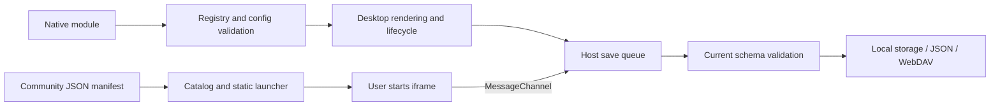

# Widget overview and architecture

[Wiki home](Home-en.md) · [简体中文](Widgets-Overview.md) · **English**

## Choose an integration model

| Dimension | Native API v3 | Community protocol v1 |
| --- | --- | --- |
| Distribution | Local ES Module, reviewed and bundled | Self-hosted HTTPS webpage and JSON manifest |
| Registration | `src/widget-extensions.js` | User subscribes to a manifest or source index |
| Desktop rendering | Author renderer at every declared size | Static launcher; webpage runs explicitly in a detail window |
| Data API | Declared `config`, `getConfig()` / `updateConfig()` | `host.data` / `host.save(value)` |
| Execution | Trusted host environment; not a sandbox | `sandbox="allow-scripts"` iframe + MessageChannel |
| Updates | Extension or web application release | Refresh the source, then explicitly update installed manifests |

Native source can access its execution environment; its API is not a permission boundary. Community APIs do not expose other desktop data, but author webpages can make network requests. See [community widgets](Community-Widgets-en.md) for isolation limits.

## Built-in catalog

The registry contains 14 user-facing built-in widget types. `community` is a separate internal type, and the legacy `hotlinks` type is retained only for compatibility with existing data. All built-ins support the five sizes.

| Type | Name | Behavior and limits |
| --- | --- | --- |
| `wallpaper` | Wallpapers | Every size opens the wallpaper center; galleries load on demand |
| `weather` | Weather | Independent city, unit and network opt-in; observations, hourly/daily forecasts and air quality |
| `calendar` | Calendar | Gregorian/lunar dates, events, date and workday tools; verified mainland China adjustments for 2026 only |
| `memo` | Memos | Multiple plain-text entries, search, pinning, sorting, autosave, undo deletion and TXT export |
| `notes` | Sticky notes | Independent text and color |
| `todo` | To-dos | Add, complete and delete tasks |
| `countdown` | Countdown | Event title and target date |
| `focus` | Focus timer | Pause/resume, restore remaining time from the end timestamp |
| `workday` | Workday countdown | Working days, end time and payday |
| `quote` | Quotes | Custom text/author or built-in quotes |
| `hotsearch` | Trending | 22 sources, categories/search, subscription ordering, single/multiple lists, refresh and local cache; opens directly to rankings |
| `calculator` | Calculator | Arithmetic, parentheses and percentages |
| `base-converter` | Base converter | Simultaneous results for bases 2–36, large integers, negatives, fractions, recurring digits and precision controls |
| `habit` | Habits | Daily records and streaks |
| `clock` | World clock | IANA timezone, city label and time comparison |

## Base converter

Add **Widgets → Tools → Base converter**. Binary, octal, decimal and hexadecimal appear together by default; add or remove any output base from 2 to 36. The 2×2 / 4×2 desktop cards show the first four results, and all five sizes open the dedicated workspace. Narrow windows stack input and results and initially collapse formatting options.

- Input is limited to 512 characters. Exact rational arithmetic preserves large integers and fractions beyond JavaScript's safe integer range. Accepts negatives, case-insensitive letters, space / underscore groups and recurring notation such as `0.(3)`. Pasting a complete `0b`, `0o` or `0x` number detects its input base.
- Choose 1–128 maximum fractional digits. Parentheses mark recurring digits; longer expansions are truncated, not rounded, and show `≈` and `…`. Negatives retain a minus sign; two's complement and scientific notation are not supported.
- Copy individual results or all results. Individual copies omit grouping spaces and announce truncation when applicable; copying all preserves base labels and approximation markers. Only exact results within the input limit can be reused as input.
- Each instance independently saves its input, output bases and formatting in desktop data, JSON backups and WebDAV. Public layout sharing resets these to defaults. Conversion needs no network access; failed saves retain session drafts and offer retry.

## Trending lists

Existing Trending links cards and `hotlinks` records in older backups upgrade automatically, preserving IDs, placement, sizes and custom names. Background updates stay off by default; there is no need to delete and recreate cards.

Add **Widgets → Trending**, then open the card to read ranks, titles and popularity immediately. The reading window uses a 1000 × 660 layout, shrinking on smaller screens and showing at least 13 ranks at its standard size. Automatic background updates are off by default; opening, switching or refreshing a list still loads it. Previously read headlines also appear in the desktop card. Zhihu, Weibo, 52pojie and GitHub are followed by default. Manage subscriptions supports adding/removing sources, dragging, up/down buttons and Alt + up/down arrow keys. The toolbar includes categories, platform search, single/multiple lists and maximize controls.

Lists use the [UAPI hotboard endpoint](https://uapis.cn/docs/api-reference/get-misc-hotboard) by default. Source settings also accept a public HTTPS service compatible with [DailyHotApi](https://github.com/imsyy/DailyHotApi). GitHub uses its public API: repositories created in the last 7 days sorted by stars; the AI list uses the last 30 days with the `artificial-intelligence` topic. These are not GitHub's official Trending lists. Entries without article links still display their titles, with a platform link available separately.

Subscriptions, order, selected platform, view and service URL are saved per instance and included in backups/WebDAV. List caches remain local, are reused for 10 minutes, and retain at most 48 lists for up to 7 days. Failed requests preserve cached content and expose retry. Closing the workspace cancels unneeded requests; multiple-list loading uses at most 3 concurrent requests. Public layout imports turn off automatic background updates. Availability and update times depend on upstream services. Serve standalone HTML over HTTP for network testing; `file://` previews may be blocked by the provider's CORS policy.

## Runtime structure



Cards and detail workspaces share instance data. Compact built-in cards show summaries. Calendar, memos and weather have dedicated detail views; other daily tools use workspace modules. Detail layouts reflow with the available space.

| Module | Responsibility |
| --- | --- |
| [widget-registry.js](../../src/widget-registry.js) | Types, API versions, fields, defaults and validation |
| [widget-extensions.js](../../src/widget-extensions.js) | Bundled definitions shared across execution contexts |
| [widget-sizes.js](../../src/widget-sizes.js) / [widget-catalog.js](../../src/widget-catalog.js) | Dimensions, catalog and static previews |
| [widget-runtime.js](../../src/widget-runtime.js) / [widget-settings.js](../../src/widget-settings.js) | Native lifecycle and generated configuration forms |
| [widgets.js](../../src/widgets.js) / [widget-summary.js](../../src/widget-summary.js) | Cards, built-in interactions and compact summaries |
| [widget-workspaces.js](../../src/widget-workspaces.js) / [widget-details.js](../../src/widget-details.js) | Daily workspaces, calendar and memo sessions |
| [calendar-view.js](../../src/calendar-view.js) / [memo-view.js](../../src/memo-view.js) / [weather-view.js](../../src/weather-view.js) | Dedicated views |
| [widget-data.js](../../src/widget-data.js) / [widget-drafts.js](../../src/widget-drafts.js) | Instance data, drafts, failed saves and retry |
| [community-format.js](../../src/community-format.js) / [community-widget.js](../../src/community-widget.js) | Manifests, instance JSON and isolated execution |
| [core.js](../../src/core.js) / [validation.js](../../src/validation.js) | Full desktop validation, storage and backups |

## Data model and limits

Each widget card has `config` and `data`. Native extensions keep declared scalar fields in `config` and use `data: {}`. Built-ins have explicit data structures; community widgets store a JSON string in `data.value`. Duplicating a card deep-copies its content; newly created cards receive fresh defaults.

```js
// Card fragment, not a complete importable desktop backup.
{
  id: 'stable-id', groupId: 'home', type: 'widget', widget: 'counter',
  title: 'Counter', size: '2x2', config: { label: 'Small wins today', count: 3 }, data: {}
}
```

| Data | Per-instance limit |
| --- | --- |
| Calendar `events` | 500 events; 160-character titles |
| Memo `entries` | 200 entries; 120-character titles and 100000-character bodies |
| Sticky `notes` | 100000 characters |
| `todos` | 500 items; 1000-character text per item |
| `habits` | 100 items; 3660 dates per item |
| `focus` | 1–180 minutes; running timers require an end timestamp |
| Community `value` | 64 KiB of UTF-8 JSON text |
| Full desktop backup | 6 MiB; web storage also depends on browser quotas |

The current format is `schemaVersion: 5`, stored under `qiye.state.v5`. Unknown types, missing/unknown fields, unsupported sizes and older formats are rejected. Import validation never fills missing fields with defaults. Do not persist DOM objects, functions, timers, credentials or caches.

## Calendar, drafts and weather

Calendar tools use local civil dates. The workday interval tool **excludes the start date and includes the end date**; the same day yields zero. The underlying `countWorkdays` function includes both endpoints, and the tool explicitly subtracts the start date. Statutory adjustments and cultural festivals are separate; unverified years are not guessed. The calendar engine is bundled offline; see [third-party notices (Chinese)](../THIRD_PARTY.md).

Editors such as memos use `widget-drafts.js` to retain failed drafts in the current page. Reloading or closing the page loses unsaved drafts: retry or export first. `Qiye-unsaved-widget.json` is not a full desktop backup. A stale draft cannot overwrite a newer revision from another tab.

Weather is disabled by default and never reads precise device location. Sources include Automatic, Open-Meteo, QWeather, Hong Kong Observatory, Taiwan CWA and Macao SMG. Automatic mode prefers the applicable regional observations, then configured QWeather, then Open-Meteo. HKO selects a nearby temperature station, CWA selects a nearby WGS84 station, and HKO/SMG supply official daily forecasts. Open-Meteo supplements hourly and missing daily forecasts, with separate attribution. Missing official observations remain unknown; qualitative rain probabilities are not converted to invented percentages. CAMS air quality is explicitly US AQI.

QWeather uses the current v1 coordinate APIs with a personal API Host and key; CWA requires a personal authorization key. Credentials remain in separate local storage, excluded from desktop exports, WebDAV and sharing. Old weather configurations inherit `source: auto` and `fallback: true`; other required fields remain strictly validated. Fallback can be disabled. Source requests time out after eight seconds (air quality: 4.5 seconds). Forecasts stay fresh for 30 minutes, retry after one minute on failure and preserve up to seven days of cached data. Cache identities include coordinates, region, source, fallback, credential revision and language. Memory holds 64 combinations and local storage 48. Web previews obey provider CORS; SMG XML requires optional origin access in the extension.

City searches time out after eight seconds and newer requests cancel earlier ones. [weather-workspace.js](../../src/weather-workspace.js) manages the workspace; [weather-chart.js](../../src/weather-chart.js) breaks curves at missing values instead of inserting zero. [weather-cities.js](../../src/weather-cities.js) separately retains eight recent cities, deduplicated by coordinates. The city rail opens by default on wide displays and can collapse on narrow ones; enabled weather loads saved-city summaries. Common mainland, Hong Kong, Taiwan and Macao searches support local simplified/traditional and English aliases, with Open-Meteo geocoding used when no local match exists. City history, credentials and weather caches are excluded from backups and WebDAV.

[Next: native widget API →](Native-Widgets-en.md) · [Community widgets →](Community-Widgets-en.md)
