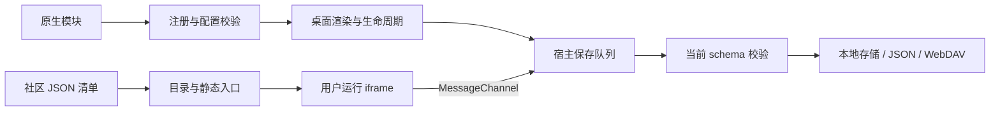

# 组件概览与架构

[Wiki 首页](Home.md) · **简体中文** · [English](Widgets-Overview-en.md)

## 接入方式选择

| 维度 | 原生组件 API v3 | 社区组件协议 v1 |
| --- | --- | --- |
| 交付方式 | 本地 ES Module，经源码审阅后打包 | 自托管 HTTPS 网页与 JSON 清单 |
| 注册入口 | `src/widget-extensions.js` | 用户订阅清单或来源索引 |
| 桌面展示 | 每个声明尺寸均使用作者渲染器 | 静态入口，详情窗口显式运行网页 |
| 数据接口 | 声明式 `config`、`getConfig()` / `updateConfig()` | `host.data` / `host.save(value)` |
| 执行环境 | 与宿主同一可信环境；不是沙箱 | `sandbox="allow-scripts"` iframe + MessageChannel |
| 更新 | 随扩展或网页版发布 | 刷新来源后，用户选择更新已添加的清单 |

原生组件源码可访问所在执行环境，API 不是权限边界。社区接口不暴露其他桌面数据，但作者网页仍可自主联网；隔离范围见[社区组件](Community-Widgets.md)。

## 内置组件目录

注册表包含 14 类用户可选内置组件；`community` 是单独的内部类型，旧 `hotlinks` 类型仅用于兼容已有数据。全部内置组件支持五种尺寸。

| 类型 | 名称 | 内容与边界 |
| --- | --- | --- |
| `wallpaper` | 在线壁纸 | 所有尺寸打开壁纸中心；图库按需联网 |
| `weather` | 天气 | 独立城市 / 单位 / 联网开关，当前天气、小时与每日预报、空气质量 |
| `calendar` | 日历 | 公历 / 农历、日程、日期与工作日工具；中国调休仅提供已核实的 2026 年数据 |
| `memo` | 备忘录 | 多条纯文本记录、搜索、置顶、排序、自动保存、删除撤销与 TXT 导出 |
| `notes` | 便签 | 桌面随手记，独立文本与颜色 |
| `todo` | 待办 | 添加、勾选、删除任务 |
| `countdown` | 倒数日 | 配置事件标题与目标日期 |
| `focus` | 专注 | 可暂停的计时器，基于结束时间恢复剩余时间 |
| `workday` | 下班倒计时 | 设置工作日、下班时间与发薪日 |
| `quote` | 每日一句 | 自定义摘录与作者，或内置短句 |
| `hotsearch` | 热搜榜 | 22 个来源，分类 / 搜索、订阅排序、单榜 / 多榜、刷新与本机缓存；点击直接查看榜单 |
| `calculator` | 计算器 | 四则运算、括号与百分比 |
| `base-converter` | 进制转换 | 2–36 进制实时互转，同时输出多个结果；大整数、负数、小数、循环节与精度设置 |
| `habit` | 习惯打卡 | 每日记录与连续天数 |
| `clock` | 世界时钟 | IANA 时区、城市标签与时间比较 |

## 进制转换

从“添加 → 小组件 → 工具 → 进制转换”添加。默认同时展示二、八、十、十六进制，可增减 2–36 进制的任意结果。桌面 2×2 / 4×2 卡片显示前四项结果，五种尺寸都能打开专用转换窗口。宽屏按输入与结果分栏，窄屏上下排列并默认折叠格式选项。

- 最多输入 512 个字符；大整数与小数通过精确分数运算转换，不受 JavaScript 安全整数范围限制。支持负数、大小写字母、空格 / 下划线分组，以及 `0.(3)` 这样的循环小数。粘贴完整的 `0b` / `0o` / `0x` 数值可自动选择进制。
- 可设置 1–128 位最大小数位数。循环节用括号标记；超出位数时截断并显示 `≈` 与 `…`，不四舍五入。负数保留负号，不使用补码，不支持科学计数法。
- 每项结果可复制或“用作输入”，后者仅接受长度在输入上限内的精确结果。复制单项去除分组空格；复制截断值会提示精度限制，复制全部保留进制名称和近似标记。
- 每个实例独立保存输入、输出进制和格式选项，包含在 JSON 备份与 WebDAV 中；分享桌面排布只带默认值。转换不联网。保存失败保留当前会话草稿并提供重试。

## 热搜榜

已有“热搜入口”卡片及旧备份中的 `hotlinks` 会自动升级为热搜榜，保留卡片标识、位置、尺寸和自定义名称；后台自动更新默认关闭，无需删除后重新添加。

从“添加 → 小组件 → 热搜榜”添加，点击卡片直接查看完整排名、标题和热度。窗口按 1000 × 660 的阅读尺寸布局，小屏自动收缩；大屏可同时看到至少 13 条排名。默认关闭后台自动更新，主动打开、切换平台或刷新仍会获取榜单；已读取的标题也会显示在桌面卡片上。默认订阅知乎、微博、吾爱破解和 GitHub；“管理订阅”支持增删、拖动、上下移动按钮及 Alt + 上下方向键排序。顶部可按分类浏览、搜索平台、切换单榜 / 多榜视图和最大化。

默认通过 [UAPI 热榜接口](https://uapis.cn/docs/api-reference/get-misc-hotboard) 获取榜单，数据源设置也支持兼容 [DailyHotApi](https://github.com/imsyy/DailyHotApi) 的公开 HTTPS 服务。GitHub 直接使用公开 API：按星数排序的最近 7 天新仓库，AI 分类为最近 30 天新建且带 `artificial-intelligence` topic 的仓库，均不是 GitHub 官方 Trending。上游没有原文链接的条目仍展示标题，并提供平台入口。

订阅、顺序、当前平台、视图和服务地址按实例保存，随备份 / WebDAV 同步；榜单缓存独立保存在本机，10 分钟内复用，最多保留 48 份、7 天。失败时保留缓存并提示重试；关闭窗口取消不再需要的请求，多榜模式最多同时获取 3 个来源。公开排布导入会关闭后台自动更新。第三方服务可用性和更新时间取决于上游；独立 HTML 的联网测试请通过 HTTP 服务打开，`file://` 预览可能受服务的跨域策略限制。

## 运行结构



卡片和详情工作区使用同一实例的数据。内置组件的紧凑尺寸显示摘要，日历、备忘录和天气使用专用详情视图；其他日常组件由工作区模块承载。详情布局根据可用空间重新排版。

| 模块 | 职责 |
| --- | --- |
| [widget-registry.js](../../src/widget-registry.js) | 类型、API 版本、配置字段、默认值和校验 |
| [widget-extensions.js](../../src/widget-extensions.js) | 随包组件登记入口，供所有运行上下文使用 |
| [widget-sizes.js](../../src/widget-sizes.js) / [widget-catalog.js](../../src/widget-catalog.js) | 尺寸计算、目录与静态预览 |
| [widget-runtime.js](../../src/widget-runtime.js) / [widget-settings.js](../../src/widget-settings.js) | 原生生命周期与自动配置表单 |
| [widgets.js](../../src/widgets.js) / [widget-summary.js](../../src/widget-summary.js) | 卡片渲染、内置交互与紧凑摘要 |
| [widget-workspaces.js](../../src/widget-workspaces.js) / [widget-details.js](../../src/widget-details.js) | 日常工具工作区、日历与备忘录详情会话 |
| [calendar-view.js](../../src/calendar-view.js) / [memo-view.js](../../src/memo-view.js) / [weather-view.js](../../src/weather-view.js) | 专用视图 |
| [widget-data.js](../../src/widget-data.js) / [widget-drafts.js](../../src/widget-drafts.js) | 实例数据、草稿、保存失败与重试 |
| [community-format.js](../../src/community-format.js) / [community-widget.js](../../src/community-widget.js) | 社区清单、实例 JSON 与隔离运行 |
| [core.js](../../src/core.js) / [validation.js](../../src/validation.js) | 完整桌面校验、持久化与备份边界 |

## 数据模型与限额

每个组件卡片包含 `config` 和 `data`。原生扩展把声明的标量字段存入 `config`，其 `data` 为 `{}`；内置组件使用明确的数据结构，社区组件用 `data.value` 存储 JSON 字符串。复制卡片深拷贝内容，新建卡片使用新默认值。

```js
// 卡片片段；不是可直接导入的完整桌面备份。
{
  id: 'stable-id', groupId: 'home', type: 'widget', widget: 'counter',
  title: '计数器', size: '2x2', config: { label: '今天的小进步', count: 3 }, data: {}
}
```

| 数据 | 每实例限制 |
| --- | --- |
| 日历 `events` | 500 条，标题 160 字符 |
| 备忘录 `entries` | 200 条，每条标题 120 字符、正文 100000 字符 |
| 便签 `notes` | 100000 字符 |
| 待办 `todos` | 500 项，每项文本 1000 字符 |
| 习惯 `habits` | 100 项，每项最多 3660 个日期 |
| 专注 `focus` | 1–180 分钟，运行状态包含结束时间 |
| 社区 `value` | 64 KiB UTF-8 JSON 字符串 |
| 完整桌面备份 | 6 MiB；网页另受浏览器存储配额限制 |

当前桌面格式为 `schemaVersion: 5`，存储键为 `qiye.state.v5`。未知类型、缺失或未知字段、非法尺寸和旧格式都会被拒绝；校验器不会用默认值补全导入数据。不要在持久数据中放 DOM、函数、定时器、凭据或缓存。

## 日历、草稿与天气的特殊约束

日历工具使用本地民用日期。工具页工作日间隔**不含开始日、包含结束日**，同一天为 0；底层 `countWorkdays` 函数采用包含首尾的计数，工具层显式扣除开始日。法定调休与传统节日分别处理，超出已核实年份不推测调休。历法引擎离线提供，来源见[第三方声明](../THIRD_PARTY.md)。

备忘录等编辑器通过 `widget-drafts.js` 保留当前页面内的失败草稿。刷新或关闭页面会丢失未保存草稿，应先重试或导出；`Qiye-unsaved-widget.json` 不是完整桌面备份。较旧草稿不能覆盖其他标签页的新修订。

天气默认禁用，不读取设备精确定位。可选自动、Open-Meteo、和风天气、香港天文台、台湾中央气象署、澳门地球物理气象局。自动模式优先香港天文台、澳门气象局和已配置的台湾气象署，其余地区优先已配置的和风天气，否则使用 Open-Meteo。香港按坐标选择附近有效温度测站；澳门与香港使用官方每日预报；台湾使用附近 WGS84 观测站。小时或缺失的每日预报由 Open-Meteo 补充，各部分单独标注来源。官方缺失的观测不填成模型值，定性降雨概率不伪造为百分比，CAMS 空气质量明确标注美国 AQI。

和风接入当前 v1 经纬度接口，需要个人 API Host / API Key；气象署需要个人授权码。密钥单独保存在本机，不进入桌面备份、WebDAV 或分享文件。旧天气配置自动补充 `source: auto` 和 `fallback: true`；其他必需配置仍严格校验。可以关闭失败回退。缓存键包括城市、地区、来源、回退开关、凭据修订及语言，避免跨来源串用。单次来源请求超时 8 秒、空气质量 4.5 秒；缓存有效期 30 分钟，普通失败 1 分钟后重试，主动刷新可立即重试；内存最多 64 个来源/城市组合，本机最多 48 个组合，保留最多 7 天旧预报。空气质量失败不丢弃有效天气。网页版遵循服务 CORS，澳门 XML 在扩展中需按需授予对应来源访问权限。

城市搜索超时 8 秒，后续请求取消前次请求。天气工作区由 [weather-workspace.js](../../src/weather-workspace.js) 管理，[weather-chart.js](../../src/weather-chart.js) 计算曲线，缺失数据断线而非填零。[weather-cities.js](../../src/weather-cities.js) 另存最近 8 城，按坐标去重；宽屏城市列表默认常驻，窄屏可收起；天气启用后读取收藏城市概况。本地常用城市索引支持内地、港澳台简繁体及英文别名，无匹配时使用 Open-Meteo 地理编码。城市历史、凭据与天气缓存不进入备份或 WebDAV。

[下一篇：原生组件 API →](Native-Widgets.md) · [社区组件 →](Community-Widgets.md)
